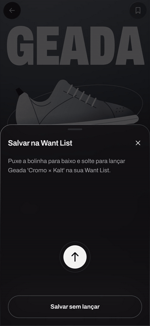
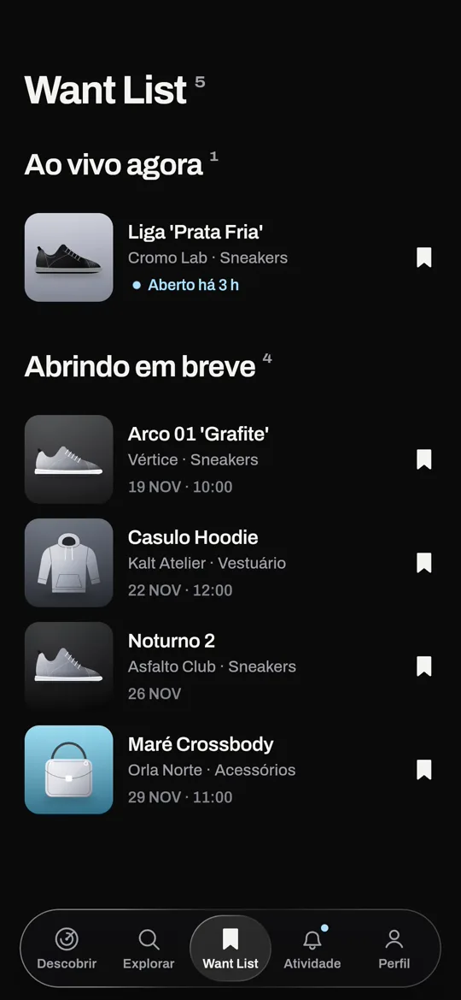

# DRIP

*The radar for drops you can't miss.*

App em Flutter que reúne lançamentos de sneakers e streetwear: mostra o que
abre hoje e o que vem aí, avisa antes dos itens salvos e leva ao **site
oficial da marca**. O DRIP não vende nada: não tem carrinho nem checkout.

<p>
  
  
  
  
</p>

> As marcas e os produtos do catálogo de exemplo são fictícios.

## Destaques

- **Estilingue para salvar na Want List.** Física feita à mão com `Ticker`:
  cápsula elástica desenhada pelas tangentes externas, alcance que endurece
  com `tanh`, 8 entalhes com vibração, tremor perto do limite, lançamento
  com gravidade e quique, mola subamortecida e faíscas em leque.
- **Vidro líquido em GLSL** (`shaders/liquid_glass.frag`): SDF de retângulo
  arredondado, refração na borda, leve ampliação no centro, aberração
  cromática e luz especular. Usa `ImageFilter.shader` onde há Impeller
  (Android, iOS, Windows) e cai para desfoque onde não há (web).
- **Barra de abas flutuante** com pílula que desliza, e **medidor de força
  da senha** com checklist animado.
- **Firebase**: login por e-mail e senha ou Google, Firestore em tempo real
  e regras de segurança que validam cada campo (`firestore.rules`).
- Respeita "reduzir movimento", alto contraste e leitor de tela.

## Como rodar

Precisa do [Flutter](https://docs.flutter.dev/get-started/install) 3.50 ou
mais novo.

```bash
flutter pub get
```

**Modo demonstração** (sem Firebase; dados só no aparelho):

```bash
flutter run
```

**Firebase local, com catálogo e contas de teste** (Windows, precisa de
Java 21+ e do [Firebase CLI](https://firebase.google.com/docs/cli)):

```powershell
.\tool\dev.ps1            # ou: .\tool\dev.ps1 -d windows / -d chrome
```

O script liga os emuladores com o projeto fictício `demo-drip`, grava os
dados de `tool/seed_emulator.dart` (as contas de teste estão lá) e abre o
app. Nada sai do seu computador.

**Seu próprio projeto Firebase:** copie `firebase.local.example.json` para
`firebase.local.json`, preencha com as chaves do seu projeto e rode:

```bash
flutter run --dart-define-from-file=firebase.local.json
```

As chaves nunca entram no Git (`.gitignore`). O passo a passo completo,
incluindo regras e índices, está em [FIREBASE.md](FIREBASE.md).

## Qualidade

```bash
flutter analyze
```

```bash
flutter test
```

Os testes cobrem modelos e regras de negócio, os repositórios locais, o
medidor de senha, o estilingue, a navegação entre abas e o caminho completo
pelo app em modo demonstração.

## Organização

```
lib/
  app/        raiz do app e rotas (GoRouter)
  core/       tema, tipografia, movimento, componentes (vidro líquido etc.)
  data/       modelos, repositórios (local e Firebase), serviços, catálogo demo
  features/   uma pasta por área do app
shaders/      shader GLSL do vidro líquido
tool/         emuladores, dados de teste e servidor da versão web
```

- Estado com Riverpod (`lib/data/providers.dart`). Cada repositório tem uma
  versão local e uma Firebase; `firebaseReadyProvider` escolhe qual usar.
- Neste Flutter o Material saiu do SDK: o import é
  `package:material_ui/material_ui.dart`.
